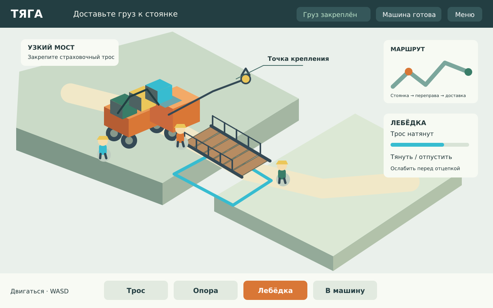

# ТЯГА — оформление, интерфейс и карты v0.1

Этот документ задаёт внешний результат и стартовые уровни до реализации. Размеры и координаты являются обязательными исходными данными v0.1; фактическая проходимость ещё должна быть проверена по [плану реализации](IMPLEMENTATION.md). Числа нельзя выдавать за результаты испытаний. Общие игровые определения находятся в [DESIGN](DESIGN.md); обязательный процесс готовых моделей и лицензий — в [ART_PRODUCTION_STANDARD](../../docs/game-design/ART_PRODUCTION_STANDARD.md).

Схема компоновки и художественного направления; геометрия уровней задаётся таблицами. Это проектная схема, не скриншот реализации и не готовый игровой ассет.

## 1. Художественное направление

ТЯГА выглядит как выразительная экспедиционная диорама с тяжёлой техникой и небольшими людьми. Массу, высоту и материал должно быть видно по самому объекту. Машина наклоняется на подвеске; настил заметно тоньше скалы; трос натягивается между реальными точками; контейнер не выглядит бумажной иконкой.

ТЯГА полностью самостоятельна по композиции, шрифтам, материалам, моделям, анимации и звуку. Она не использует общий игровой HUD с «Форпостом» и не наследует шахматные панели после перекраски. Собственное направление — округлая техника, природные поверхности, плавные движения и компактные плавающие инструментальные панели. Общими могут быть аккаунт и технические компоненты доступности; вид игрового экрана создаётся отдельно.

Для интерфейса фиксируется Golos Text 400/500/700, для коротких названий и номерных табличек Rubik 700. Перед включением файлов исполнитель проверяет источник, право распространения и кириллицу; это выбранные семейства, не заявление об уже полученной лицензии. Масштабирование текста проверяется после интеграции настоящих файлов. На кнопках нет имитации терминала или военного прицела.

Формы слегка преувеличены для читаемости: широкие колёса, большие проушины, крупная ручка домкрата, заметные патрубки насоса. Реалистичную грязь и ржавчину применяют умеренно. Изношенность не должна скрывать крепления. На важных узлах оборудования есть небольшие контрастные цветовые вставки.

| Назначение | Цвет |
|---|---|
| Основной кузов | Тёплый оранжевый #D97736 |
| Сталь и крепёж | Тёмная сталь #344955 |
| Основная растительность | Хвойный #397D68 |
| Светлый камень и спокойный фон | #DCE8E4 |
| Вода и активный инструмент | Бирюзовый #37BCD0 |
| Предупреждение о нагрузке | Жёлтый #EBC75A |
| Подтверждённая опасность | Красный #D64A43 |
| Текст на светлой панели | #20333B |
| Светлый текст | #F5F7F2 |

Цвет участника относится к одежде, маркеру и маленькому знаку над головой. Важный груз не меняет свой материал в цвет человека, который его держит. Для участников используются шесть различимых цветов и шесть форм значка: круг, ромб, треугольник, квадрат, пятиугольник, крест. Имя доступно по касанию и в командном списке.

У первой карты тёплый дневной свет, зелень и светлые берега; у второй — влажный камень, вода и промышленная фактура; у третьей — холодная высота, сухая трава, снежные пятна и длинные тени. Случайного времени суток в v0.1 нет. Одинаковые материалы всегда имеют одинаковое физическое значение, даже при различном освещении.

## 2. Что именно означает 2.5D

Мир, персонажи, грузы, мосты и тросы — настоящие трёхмерные объекты. Рендер использует Three.js и ортографическую камеру. Стороны контейнера, днище машины, промежутки между опорами и пространство под настилом существуют в геометрии. Коллайдер нельзя заменять плоским прямоугольником XZ, если это уничтожает взаимодействие по высоте.

Камера фиксирует азимут 45° и наклон 55° вниз. Положение рассчитывается из этих углов; отдельный приблизительный вектор положения не хранится как второй норматив. Ручного поворота нет. Масштаб изменяется колесом или двумя пальцами в диапазоне 0,75–1,6 от базового.

Базовая вертикальная видимая высота мира: 18 м на компьютере, 14 м в горизонтальном телефоне, 24 м в вертикальном телефоне. При узком соотношении сторон высота дополнительно увеличивается так, чтобы горизонтальная видимая ширина мира была не меньше 13 м. Масштаб интерфейса от масштаба мира не зависит.

Пока персонаж находится не дальше 12 м от машины, фокус равен 65% его положения плюс 35% положения машины. При большем расстоянии камера следует за персонажем. Для водителя фокус находится на кузове и смещается по движению максимум на 2 м. Сглаживание движения камеры имеет постоянную времени 0,18 секунды. Поворот камеры не используется для объяснения отдельного действия.

Заслоняющая персонажа высокая стена плавно становится полупрозрачной только визуально. Её контур и верхняя кромка остаются видны, а физический коллайдер не меняется. Важный предмет за стеной можно обозначить силуэтом, но взаимодействие по-прежнему требует прямой видимости и допустимой дистанции.

Для оценки высоты у выбранного груза показывается тонкая вертикальная линия к ближайшей опоре и небольшая тень. У крепёжной точки видно, к какому телу она относится. Предпросмотр настила учитывает полный занимаемый объём и подсвечивает помеху. Нельзя показывать зелёную возможность там, где сервер откажет из-за крыши, стены или чужого предмета.

## 3. Экран компьютера

Игра занимает основную часть окна; карта не заключена в маленькую карточку кабинета. Верхняя строка высотой до 64 px содержит название участка, три груза с целостностью, состояние машины и кнопку меню. Постоянные числовые показатели ограничены этими данными.

Справа сверху находится миникарта размером 180 × 140 px с персонажами, машиной, последней стоянкой и текущей целью. Она сворачивается до круглой кнопки. Открытие большой карты временно занимает правую треть экрана, но не останавливает общую симуляцию.

Внизу показываются выбранный предмет, короткая команда и её кнопка. При работе лебёдкой дополнительно видны длина, нагрузка и направление намотки; при вождении — скорость, тормоз и нагрузка кузова; при строительстве — объём и причина невозможности. Неактуальные панели полностью убираются.

Справа размещается список участников с состоянием контроллера: человек, бот или ожидание связи. Для бота доступно меню конкретного поручения. Журнал действий открывается отдельной панелью и содержит только полезные события: закрепление, повреждение, разрыв, доставка, смена контроллера, сохранение.

Клавиатура: WASD или стрелки — движение; Shift — бег; Space — прыжок; E — взаимодействие; Q — отпустить ручку или выйти из инструмента; R — контекстное вращение предпросмотра на 15°; F — открыть крепления; M — карта; Escape — меню. При вождении W/S дают тягу, A/D — руль, Space — тормоз. При лебёдке W/S наматывают и выпускают, Space удерживает нейтраль. Переключение контекста всегда показывает новую короткую памятку.

Нажатие меню не ставит сетевую игру на паузу. Непрерывное действие при потере фокуса окна получает нейтральную команду. Подтверждение rewind и сохранения использует общее голосование из DESIGN.

## 4. Телефон, планшет и доступность

Проверяемые минимальные размеры экрана — 360 × 640 px вертикально и 640 × 360 px горизонтально. Безопасные поля устройства учитываются. Ни одно обязательное действие не требует наведения, физической клавиатуры или одновременного касания трёх точек.

Слева снизу расположен стик движения диаметром 104 px с зоной касания 128 px. Справа — прыжок, основное действие и отпускание; размер цели каждой кнопки не меньше 48 × 48 px, промежуток не меньше 8 px. Дополнительные крепления открываются контекстной кнопкой, а не ещё одной постоянной полосой.

На портретном экране верхняя строка переносится в две компактные строки до 88 px. Три груза показываются узнаваемыми значками с дугой состояния; числовое значение открывается нажатием. Нижняя карточка предмета занимает не больше 25% высоты и не перекрывает стик. Полная карта открывается поверх мира и закрывается одним явным действием.

Вождение использует тот же левый стик для руля и тяги; справа большая кнопка тормоза и выход. Лебёдка заменяет стик инструментальным ползунком «выпустить — удержать — тянуть». Возвращение к ходьбе требует видимого выхода из инструмента. Вращение строительного предпросмотра выполняется двумя отдельными кнопками, а не сложным жестом.

Предусмотрены увеличенный текст до 130%, настройка силы тряски, отключение вспышек и режим уменьшенного движения. Уменьшенное движение убирает декоративные качания интерфейса и тряску камеры, но сохраняет физическое перемещение предметов. Звук не является единственным каналом предупреждения: нагрузка и направление опасности имеют видимый знак.

Кнопки, ошибки и обучение имеют полные русскую и английскую версии. Названия действий короткие: «Закрепить», «Отпустить», «Тянуть», «Сохранить стоянку». Игрок не видит внутренних слов epoch, snapshot, ACK или сериализации. Полная причина ошибки остаётся в техническом журнале; интерфейс объясняет, что сделать.

## 5. Ассеты, движение и звук

| Набор | Обязательный состав |
|---|---|
| Машина | Один GLB кузова, четыре колеса, подвеска, руль, барабан, кабина, восемь крепёжных колец |
| Персонажи | Один общий скелет, шесть материалов одежды, по два варианта головы и рюкзака |
| Важный груз | Три крупных GLB основных грузов и три меньших вспомогательных блока; собственные крепления и состояния повреждения |
| Инструменты | Домкрат, якорь, переносная лебёдка, крюк, ремень, ремонтный заряд |
| Материалы | Сложенный и раскрытый настил, балка, ящик оборудования |
| Мир | Камень, земля, грязь, дерево, вода, лёд; модульные скалы и растительность |
| Крупные механизмы | Два понтона, палуба парома, винт с румпелем, переносной привод, подъёмная платформа и передача |
| Разметка | Стоянка, конечная станция, скальное кольцо, опасная кромка, маршрутная табличка |

Физический коллайдер и визуальная модель имеют общий локальный origin и явно заданные attachment points. Масштаб импорта 1 единица = 1 метр. Колёса и вращающиеся рукоятки не запекаются в единую неподвижную сетку. Физические точки ремней проверяются на реальной модели, а не добавляются по приблизительной картинке.

Персонажу нужны idle, walk, run, jump, fall, land, two-hand carry, push, hold, crank, repair, driver и short stumble. Анимация рук тянется к фактической ручке в допустимом диапазоне. Если тело предмета ушло дальше предела удержания, анимация переходит в отпускание; она не вытягивает руки бесконечно.

Кузов наклоняется по серверной физике. Декоративные колебания подвески не должны расходиться с контактами колёс. Барабан вращается в соответствии с выпущенной длиной троса. У натянутой связи меняется форма и появляется короткая вибрация; жёсткость не изображается светящимся лазером.

Нужен звуковой набор: шаги по пяти поверхностям, прыжок и приземление, двигатель, нагруженный двигатель, тормоз, намотка, холостой барабан, напряжение троса, разрыв, металлический удар, деревянный удар, закрепление ремня, домкрат, ремонт, повреждение груза, вода, ветер, стоянка, голосование, успех и потеря груза. Короткие сигналы не перекрывают общение. Голосовой чат не требуется первой версией.

Для эффектов используются собственные записи, синтез или материалы с проверенной лицензией; происхождение каждого готового файла записывается при создании. Данный документ не утверждает, что такие файлы уже существуют. Новые контентные файлы должны быть локальными ресурсами сборки, без загрузки случайного звука из внешнего URL.

Исполнитель проходит весь цикл: поиск подходящих лицензированных 3D-моделей; фиксация источника и лицензии; проверка силуэта, масштаба, устройства частей и пригодности к анимации; адаптация геометрии и материалов; создание собственной модели, если подходящей нет; подготовка движения и звука; проверка производительности и читаемости; интеграция; фактическая приёмка в игре. Отсутствие подходящей готовой модели переводит работу к собственному моделированию и не завершает задачу.

Примитивы допустимы только в технических сценах проверки. Финальная машина, большой груз, персонажи и основные инструменты должны иметь законченные формы, материалы, крепления, состояния и движение. Нельзя объявить карту принятой по скриншоту красивого фона, пока на ней стоят временные коробки. Производственный набор включает исходник модели, экспорт GLB, описание материалов, collision-прокси, attachment points и запись о происхождении; последующая сборка не требует ручного восстановления этих данных.

Рабочие бюджеты искусства: персонаж до 8000 треугольников, машина до 30000, отдельный важный груз до 5000, обычный инструмент до 2000. Основные текстуры до 1024², общие материалы и повторяющиеся объекты инстансятся. Это ограничения подготовки ассетов, а не измеренное быстродействие.

## 6. Формат геометрии карты

Все координаты в таблицах имеют порядок (X; Y; Z), расстояния в метрах. Y означает высоту опорной поверхности. Координата предмета относится к его нижней опоре, если явно не сказано «центр». Грузовая площадка и центры персонажей располагаются выше неё автоматически по своим размерам.

Каждая карта содержит геометрию поверхности, дорожные полосы, пропасти, водные объёмы, материалы, статические точки крепления, динамические препятствия, стартовые предметы, стоянки, финиш и граф допустимых переходов. Высота на прямом участке между точками маршрута интерполируется линейно. Ширина полосы измеряется перпендикулярно её оси.

Доступная дорожная поверхность строится как объединение указанных полос. Неописанное пространство между ними заполняют крутые скалы, глубокая вода или ограждённая декоративная земля; оно не должно образовывать случайный плоский объезд всех препятствий. Видимые стены и ограждения имеют настоящие коллайдеры. Пешеходные тропы шириной 1,2 м проходят к кольцам и промежуточным опорам; машине шириной 2,6 м они недоступны.

Зона стоянки — горизонтальная прямоугольная площадка 14 × 14 м. Внешняя разметка не является физическим бортиком. На ней достаточно места для машины, трёх выгруженных контейнеров и шести людей. Финиш имеет размер 16 × 14 м. Края и текущая допустимость показываются без обязательного открытия карты.

Начальные грузы закреплены восемью ремнями, ящик — ещё двумя. Для большого генератора и насосной установки центр в локальной плоскости XZ равен (−0,65;0); два вспомогательных блока стоят в передней полосе с X = 1,7 и Z = ±0,6. Для мачты её центр (0;0), опорные стойки X = ±1,6, а вспомогательные блоки находятся ниже мачты при X = ±0,7 и Z = 0. Подрамный ящик не пересекается с этими телами.

Большой генератор имеет габариты 3,4 × 2,2 × 2,1 м и массу 750 кг; мачта — 7,2 × 1,0 × 0,9 м и 520 кг; насос — 3,2 × 2,7 × 2,8 м и 900 кг. У мачты учитывается полный семиметровый габарит на повороте, у насоса — ширина 2,8 м и высокая середина массы. Начальные тела обязаны иметь реальные опоры и устойчивые связи; подмена большого груза одинаковым маленьким ящиком не принимается.

## 7. Карта 1 — «Мостовая долина»

Размер мира 180 × 64 м. Порог пропасти Y = −12 м. Начальная машина стоит по направлению +X в (12; 0; 32). Погода постоянная, ветра нет. На пути находятся повреждённый мост, крутой подъём и неровный выход к станции.

| Узел | Координаты / геометрия | Назначение |
|---|---|---|
| Старт | (12; 0; 32), площадка 18 × 16 | Подготовка и разгрузка |
| Подход к реке | (32; 0; 32), дорога шириной 6 | Выбор переправы |
| Разрыв моста | X 44,5–51,5; Z 29,5–34,5; дно Y −4 | Основное препятствие |
| Центральная опора | Центр (48; 0; 32), верх 1 × 4 | Опора двух настилов |
| Стоянка 1 | (76; 0; 32) | Новый полный checkpoint |
| Подъём | (94;0;32) → (102;1;32) → (110;5;32) → (118;6;32), ширина 4 | Крутая средняя часть |
| Стоянка 2 | (132; 6; 32) | Сохранение на плато |
| Неровный выход | X 146–151; Z 29–35, уступ 0,55 | Короткое применение домкрата или настила |
| Финиш | (168; 6; 32) | Доставка |

Основной мост восстанавливается двумя настилами с центрами в плане (X=46; Z=32) и (X=50; Z=32), продольной осью X. Нижняя плоскость Y = 0, верхняя Y = 0,18. Торцы сходятся при X = 48 без пересечения объёмов; каждый настил опирается на берег и половину центральной опоры по 0,5 м. Команда переносит их вдвоём или подаёт лебёдкой. Доступ к центральной опоре обеспечивается пешеходными камнями с разрывами до 1,5 м; их верх Y = 0,1, ширина 1,2 м.

Альтернатива мосту — брод по оси (32;0;32) → (36;−0,2;50) → (60;−0,2;50) → (68;0;32), ширина 5 м. Вода имеет поверхность Y = 0, глубину 0,2 м на полосе и грязевой материал. Брод требует меньшего строительства, но легче потерять тягу с тяжёлым кузовом. Скальные кольца находятся в (40;0,4;54) и (62;0,4;46); к ним ведут тропы.

На подъёме кольцо в (115;6,5;32) позволяет тянуть машину с остановки перед крутой частью. Второй способ — временно выгрузить тяжёлые предметы и поднять их отдельными рейсами. Третий — длинный объезд шириной 4 м по (90;0;32) → (90;0;16) → (122;6;16) → (126;6;32). Этот путь не имеет крутого среднего участка, но содержит две тесные смены направления с расширениями 8 × 8 м.

Последний уступ допускает подкладывание настила, работу домкратом или объезд по боковой земляной дуге через (147;6;43), шириной 4 м. Нельзя требовать обязательного расхода единственного предмета: после брода или моста должны оставаться разные средства завершить путь.

Начальный комплект — базовый из DESIGN: 4 настила, 4 балки, переносная лебёдка, 4 якоря, 10 ремней, 2 домкрата, 6 ремонтных зарядов. Главный груз — большой генератор, дополнительные — оптический блок и насос. Полезная нагрузка: 970 кг грузов + 711 кг оборудования = 1681 кг при допустимых 2100 кг. Полная масса машины 2731 кг. Дополнительных предметов на карте нет.

Приёмочные маршруты: мост → лебёдка на крутом подъёме → настил на уступе; брод → длинный объезд → боковая дуга. Оба должны закончиться вдвоём без ботов и одним человеком с помощником. Самопроизвольное сохранение после пересечения географической точки не допускается.

## 8. Карта 2 — «Затопленный карьер»

Размер 224 × 96 м. Порог пропасти Y = −18 м. Старт (12;0;48), направление +X. Погода пасмурная; на нижнем уровне вода движется вдоль +Z. Карта проверяет устойчивость на мокрой опоре, удержание груза и перемещение тяжёлого препятствия.

| Узел | Координаты / геометрия | Назначение |
|---|---|---|
| Спуск | (30;0;48) → (45;−4;48), ширина 5 | Вход в карьер |
| Затопленная полоса | X 45–72, Z 45,5–50,5, дно Y −4 | Основной низкий маршрут |
| Подъём из воды | (72;−4;48) → (90;0;48) | Возврат на верх |
| Стоянка 1 | (100;0;48) | Сохранение |
| Наклонная полка | (120;0;48) → (146;4;48), ширина 4 | Поперечный уклон 18° |
| Стоянка 2 | (162;4;48) | Подготовка финала |
| Блок дороги | Центр (186;4;48), размер 3,6 × 1,2 × 2,8, масса 280 кг | Подвижный бетонный блок |
| Финиш | (210;4;48) | Доставка |

Вода имеет средний уровень Y = −3,2 м и меняется на ±0,25 м по синусоидальному циклу 90 секунд. Начальная фаза — средний уровень с подъёмом. Текущий уровень и направление изменения видны по рейке берега. Поток создаёт на полностью погружённую грань силу 250 Н на квадратный метр в направлении +Z, пропорционально погружённой площади.

Кольца низкого маршрута расположены в (44;−2,8;43), (60;−2,8;43), (76;−1,2;43). Машина может проходить последовательно со страховкой, а грузы — предварительно перевозиться по верхнему пути. Не требуется угадывать будущую случайную волну: вся вода в этой карте следует опубликованному циклу.

Верхний обход идёт по (30;0;48) → (36;1;24) → (75;1;24) → (90;0;48), ширина 4 м. На X 52,5–59,5 расположен мостовой разрыв, центр промежуточной опоры (56;1;24), верх 1 × 4 м. Настилы имеют центры X = 54 и 58, Z = 24, нижнюю плоскость Y = 1; их торцы сходятся при X = 56. Опирание на берег и соответствующую половину опоры равно 0,5 м. Обход избегает воды, но требует переноса оборудования.

Третий маршрут — паром через боковую чашу карьера. Водный объём X 38–86, Z 56–72 имеет дно Y = −6 и тот же уровень воды. Подъезд к ближнему причалу: (30;0;48) → (36;−2,8;64); выезд дальнего: (84;−2,8;64) → (90;0;48). Причалы шириной 8 м имеют поворотные рампы длиной 3 м и шириной 3,4 м, которые опираются на палубу физически.

Комплект парома находится у (43;−2,5;64): два понтона с центрами XZ (43;62,3) и (43;65,7), платформа над ними на сборочных домкратах, привод на причале (36;−2,8;60). Край ближнего причала X = 38,5, задний край палубы X = 38,8: между твёрдым берегом и корпусом остаётся 0,3 м, перекрываемые рампой, без пересечения объёмов. Нижний уровень платформы на сборочных домкратах Y = −2,50; равновесная высота центров свободных пустых понтонов при среднем уровне воды Y = −2,9167. Один понтон смещён по Z наружу на 0,7 м: команда подтягивает его, закрывает четыре замка, устанавливает привод и опускает опоры.

После загрузки машина массой 2579 кг и шесть персонажей дают 3059 кг полезной нагрузки, ниже предела парома 3500 кг. Вместе с паромом масса 3779 кг, расчётная осадка около 0,394 м; надводный запас около 0,256 м. Мачта длиной 7,2 м помещается вдоль палубы 8,4 м, но её поворот возле причала требует свободного пространства. Палуба шириной 4,2 м оставляет возле машины по 0,8 м для персонажей диаметром 0,6 м.

Кольца причалов стоят в (38;−2,5;60) и (84;−2,5;68). Тросы помогают отчалить и остановиться; вся дистанция между берегами больше длины троса, поэтому середина перехода требует привода. Удерживать оба береговых конца одновременно нельзя. Два человека могут собрать и провести паром: один работает с лебёдкой, второй направляет понтон, затем оба меняют занятие.

На наклонной полке поверхность понижается поперёк Z: высокая сторона Z = 46, низкая Z = 50. Поперечный уклон плавно растёт от 0° при X = 120 до 18° при X = 124, сохраняется до X = 140 и уменьшается до 0° при X = 146; это исключает искусственный вертикальный шов на въезде. За низкой кромкой обрыв до Y = −10. Кольца высокой стороны стоят в (124;2;44) и (140;4,5;44). Страховка ограничивает боковое движение физической связью, не отменяя крен.

Обход полки проходит по (114;0;48) → (120;0;76) → (151;4;76) → (154;4;48), ширина 5 м. На прямой есть канавка шириной 3,2 м между X 134 и 137,2; один четырёхметровый настил перекрывает её с опиранием 0,4 м. Это более длинный путь с расходом отдельного настила.

Бетонный блок перед финишем можно оттянуть к площадке (186;4;39), вытолкнуть кузовом в боковой карман либо обойти узким поворотом через (183;4;58) и (194;4;58), ширина 3,6 м. Блок не открывается нажатием специальной кнопки: его положение задаёт физическое тело.

Комплект в машине: 3 настила, 6 балок, переносная лебёдка, 6 якорей, 12 ремней, 2 домкрата, 8 ремонтных зарядов. Основной груз — оптическая мачта, дополнительные — генератор и насос. Полезная нагрузка 840 + 689 = 1529 кг, полная масса 2579 кг. В нише (82;1;20) лежат две дополнительные балки и один ремонтный заряд с собственными ID. Подбор увеличивает массу. Береговой паром в эти суммы не включён.

Проверяются три полных решения: низкая вода со страховкой → полка со страховкой → оттягивание блока; верхний мост → длинный обход полки → боковой поворот; паром → полка → перемещение блока кузовом. Вода не повреждает груз, центр которого выше поверхности, а визуальная рябь не изменяет физический уровень.

## 9. Карта 3 — «Ветровой хребет»

Размер 260 × 104 м. Порог пропасти Y = −30 м. Старт (12;0;52), финиш на высоте 16 м. Погода сухая и ветреная. Главные задачи — подъём с тяжёлым грузом, переправа на высоте и последний крутой въезд.

| Узел | Координаты / геометрия | Назначение |
|---|---|---|
| Первый подъём | (30;0;52) → (44;2;52) → (64;10;52) → (78;10;52), ширина 4,5 | Тяга и разгрузка |
| Стоянка 1 | (92;10;52) | Сохранение |
| Ущелье | X 115,5–126,5; Z 48–56; дно Y −20 | Три пролёта настилов |
| Опоры | (119;10;52), (123;10;52), верх каждой 1 × 4 | Промежуточные опоры |
| Стоянка 2 | (164;10;52) | Подготовка к станции |
| Последний въезд | (200;10;52) → (215;16;52), ширина 4 | Уклон около 22° |
| Финиш | (242;16;52) | Доставка |

Первый подъём допускает последовательную тягу с колец (48;4;49) и (67;10,5;49), разгрузку и отдельный перенос контейнеров либо серпантин через (30;0;26) → (60;6;26) → (82;10;40) → (84;10;52). Ширина серпантина 4 м, площадки поворотов 9 × 9 м. Все обязательные грузы доступны тому же инструментальному набору.

Мост над ущельем собирается из трёх настилов с центрами X = 117; 121; 125, нижней плоскостью Y = 10, верхней Y = 10,18, Z = 52. Торцы сходятся при X = 119 и 123; каждый прилегающий край имеет 0,5 м опоры, объёмы настилов не пересекаются. Опоры имеют пешеходные металлические лестницы с верхнего края; ступеньки не выше 0,22 м. Трёхмерный путь человека к опоре должен существовать в коллизиях, а не только в рисунке.

Альтернатива — нижняя полка по (104;10;52) → (108;8;82) → (138;8;82) → (150;10;52), ширина 3,4 м. На ней два уступа высотой 0,55 м, X 117 и X 131. Их проходят настилом, домкратом или после выгрузки части вещей. Полка защищена скалой от основной части ветра и требует более аккуратных поворотов.

Ветер направлен вдоль +Z. Базовая сила равна 35 Н/м² проекции тела; каждые 24 секунды наступает шестисекундный порыв 180 Н/м². За 3 секунды до порыва усиливается видимый поток пыли и появляется указатель. Первая фаза начинается с 12 секунд спокойного ветра. В нижнем обходе множитель ветра 0,25. Положение тела и его реальная площадь определяют силу, а закрепления передают её машине.

Перед последним подъёмом есть кольцо (219;16,5;49). Можно подняться лебёдкой, уменьшить нагрузку несколькими рейсами или использовать обход через (188;10;28) → (224;16;28) → (232;16;52), ширина 4 м. На обходе нет внезапной разрушаемой геометрии. Сложность заключается в более длинном пути и боковом ветре.

Ещё одна альтернатива последнему подъёму — подъёмная платформа в (222;10;72), верхняя остановка (222;16;72). Нижний подъезд идёт через (202;10;72) и (216;10;72), верхний выезд — через (230;16;72) к (238;16;52). Направляющие стоят по углам прямоугольника 9,2 × 5,0 м, сечение стойки 0,3 × 0,3 м; нижняя грань верхней перекладины Y = 21,5 м. Платформа размером 8,4 × 4,2 м принимает машину, широкий насос и людей в боковых проходах по 0,7 м. Въездные барьеры имеют проём шириной 3,4 м, переходные аппарели — длину 1,5 м.

Рама, канаты и платформа уже стоят, но привод лежит на площадке (212;10;68). Команда переносит его к неподвижной передаче, проверяет барьеры и физически поднимает машину. К месту установки ведёт боковая служебная лестница шириной 1,2 м со ступенями 0,22 м; привод можно подтянуть по ней лебёдкой. Полная масса машины 2937 кг плюс шесть людей 480 кг даёт 3417 кг полезной нагрузки, ниже предела 3800 кг. Платформа добавляет 520 кг: суммарный вес около 38600 Н, ниже предела тяги 60000 Н. Верх насоса после подъёма находится ниже перекладины с запасом не меньше 1 м.

На платформах и поворотах проверяется фактический ширинный габарит насоса 2,8 м. Узкий нижний обход 3,4 м оставляет 0,3 м с каждой стороны при прямом положении, поэтому боковой крен и поворот имеют значение. Перед въездом есть площадки 9 × 9 м для выравнивания.

Комплект в машине: 4 настила, 4 балки, переносная лебёдка, 4 якоря, 12 ремней, 2 домкрата, 8 ремонтных зарядов. Главный груз — насосная установка, дополнительные — генератор и оптический блок. Полезная нагрузка 1160 + 727 = 1887 кг при пределе 2100 кг. Полная масса 2937 кг. Привод подъёмника находится на его площадке и не включён в начальную нагрузку. На первой стоянке есть две площадки для временной выгрузки; это обычные поверхности.

Приёмочные решения: прямой подъём с лебёдкой → трёхсекционный мост → подъём с разгрузкой; серпантин → нижняя полка → длинный финишный обход; серпантин → мост → подъёмная платформа. Каждая последовательность проверяется двумя людьми и человеком с ботом. Ожидание спокойной фазы ветра не причиняет скрытого штрафа.

## 10. Читаемость и контроль геометрии

У каждого опасного участка должны быть видны начало, ближайшая опора и последствие падения. Глубину пропасти передают вертикальная стенка, тень и фон ниже, а не одна чёрная текстура. Переход физического материала обозначают рисунок и звук. Не следует разбрасывать одинаковые декоративные балки рядом с настоящими интерактивными.

На всех картах проверяются положение шести людей, полный кузов, две натянутые лебёдки, разложенный настил и открытая контекстная панель одновременно. Если в такой сцене нельзя выбрать нужную проушину, проблема исправляется компоновкой и приоритетом выбора, а не увеличением дальности взаимодействия.

Геометрический валидатор проверяет границы мира, уникальность ID, коллизии стартовых предметов, наличие пешеходного доступа к кольцам, размеры стоянок, соединённость маршрутов и опирание заявленных настилов. Успех валидатора подтверждает согласованность данных; проходимость физической машины и качество вида подтверждаются отдельными реальными запусками.
